# Geração de Questões Inéditas de Matemática no ENEM (PoT + ChromaDB)

Projeto local para elaboração, validação e persistência de **questões inéditas de Matemática alinhadas à Matriz de Referência do ENEM** (Competências `C1` a `C7`, Habilidades `H01` a `H30`, com **28 habilidades ativas** para geração).

> **Aviso sobre Escopo de Habilidades (`H06` e `H20`)**: As habilidades **H06** (localização/movimentação em mapas e croquis) e **H20** (interpretação de gráficos cartesianos) foram desabilitadas para geração e removidas do acervo histórico (`questoes_enem` e ChromaDB). Como a grande maioria das questões dessas duas habilidades exige interpretação puramente visual e a raspagem dos microdados do ENEM resultou em apenas cinco itens sem imagem ao todo, a amostragem foi considerada insuficiente para contextualização RAG. Dada a delimitação técnica deste projeto para LLMs locais estritamente textuais (Qwen 2.5 7B), o sistema conta com uma proteção estática que rejeita imediatamente qualquer tentativa de geração para H06 ou H20 (`HabilidadeDesabilitadaError`).

---

## 🔄 Fluxo de Geração em 5 Etapas

```mermaid
---
config:
  layout: dagre
  theme: redux-color
---
flowchart LR
 subgraph S1["1. Ancoragem RAG e Contextualização"]
        RAG["Busca no Banco Vetorial (Questões Históricas)"]
        Tema["Sorteio Criativo de Tema e Tipologia"]
  end
 subgraph S2["2. Geração PoT (LLM em 2 Fases)"]
        Fase2A["Fase 2A: Enunciado, Planejamento e Erros Típicos"]
        Fase2B["Fase 2B: Solver Python (def resolver)"]
  end
 subgraph S3["3. Execução e Consistência Numérica"]
        Exec["Execução do Solver em Subprocesso Isolado"]
        Nexo["Nexo Numérico e Resolução de Colisões"]
        Montagem["Embaralhamento das Alternativas A-E"]
  end
 subgraph S4["4. Validação Cega (Anti-Sycophancy)"]
        Cega["Resolução Cega pelo LLM (Sem alternativas)"]
        Equiv{"Confronto: Solver == Resolução Cega?"}
        Audit{"Auditoria Pedagógica e Semântica do Item Gerado"}
  end
 subgraph S5["5. Persistência e Retroalimentação"]
        Sucesso[("Questão Inédita Validada")]
        Retry["Engine de Retry com Feedback Corretivo"]
        Falha(["Limite de Tentativas Atingido"])
  end
    Start(["Entrada: Habilidade ENEM (H01 a H30)"]) --> RAG & Tema
    RAG --> Fase2A
    Tema --> Fase2A
    Fase2A --> Fase2B
    Fase2B --> Exec
    Exec --> Nexo
    Nexo --> Montagem
    Montagem --> Cega
    Cega --> Equiv
    Equiv -- Sim --> Audit
    Audit -- Aprovada --> Sucesso
    Exec -. Timeout ou Erro AST .-> Retry
    Nexo -. Sem nexo ou colisão .-> Retry
    Equiv -- Divergência --> Retry
    Audit -- Reprovada --> Retry
    Retry -- "Tentativa &lt;= Max (novo tema, tipologia, RAG + hint)" --> S1
    Retry -- Tentativa > Max --> Falha
```



---

## 🚀 Arquitetura e Diferenciais Técnicos

1. **Program-Aided Generation (PoT)**:
   - O LLM local (**Qwen 2.5 7B** via Ollama) elabora o planejamento, situação-problema e a função Python `def resolver():`.
   - Um interpretador isolado (`CodeExecutor`) executa os cálculos em subprocesso com timeout de 5 segundos, garantindo **100% de precisão aritmética**.
2. **Segurança Estática via AST**:
   - Bloqueio estático de chamadas e módulos de rede, sistema operacional e reflexão dinâmica (`os`, `sys`, `subprocess`, `eval`, `open`, etc.).
3. **Nexo Numérico Estrito (*Groundedness*) via Backward Slicing**:
   - Todo número usado no cálculo do gabarito deve constar explicitamente no enunciado ou na tabela, com suporte a numerais por extenso e conversões percentuais.
4. **Auto-Healing Algorítmico & Shuffling A–E**:
   - Cura determinística em 0ms para até 1 distrator colidente e embaralhamento com random seed das alternativas A a E (o LLM nunca escolhe a letra do gabarito).
5. **Validação Cega (Etapa 4) contra Viés de Confirmação (*Sycophancy*)**:
   - **4.1**: Resolução Cega Pura (o LLM resolve a questão sem alternativas e sem gabarito, reportando premissas implícitas e dados ociosos).
   - **4.2**: Confronto Direto de Equivalência com *Early Exit*.
   - **4.3**: Auditoria Pedagógica e Semântica com 5 critérios objetivos.
6. **Rastreabilidade e Retry com Feedback (Etapa 5)**:
   - Cada ciclo (`CicloGeracao`) e cada tentativa (`TentativaGeracao`) são registrados, inclusive as saídas reprovadas com `etapa_falha` e `codigo_erro`; falhas geram uma diretriz corretiva para a próxima tentativa.
7. **Acervo Histórico e ChromaDB Local**:
   - Acompanha o dataset bruto `data/itens_prova_2009_2024_enriquecido.csv` com mais de 400 questões históricas do ENEM (2009–2024).
   - Banco vetorial local **ChromaDB** persistido em disco (`./chroma_db`), indexado com o modelo `intfloat/multilingual-e5-large`.

---

## 📁 Estrutura de Diretórios

```
questoes-ineditas-enem/
├── app/
│   ├── cli.py                   # Implementação da CLI tradicional (argparse puro)
│   ├── core/                    # Configurações Pydantic, prompts PoT e sanitizadores
│   ├── db/                      # SQLAlchemy 2.0 (Habilidade, Enem, Inedita, CicloGeracao, TentativaGeracao)
│   ├── schemas/                 # Schemas tipados Pydantic v2 e JSON Schemas Ollama
│   └── services/                # CodeExecutor, QuestionService, LLMClient, ChromaVectorStore
├── data/
│   ├── habilidades_queries.json                # 30 habilidades com queries expandidas e tipologias
│   └── itens_prova_2009_2024_enriquecido.csv   # Dataset raw de questões históricas do ENEM
├── scripts/
│   ├── seed_habilidades.py           # Popula H01 a H30 no banco
│   ├── seed_questoes.py              # Popula acervo histórico no banco relacional
│   ├── seed_chroma.py                # Indexa o CSV histórico no ChromaDB local
│   └── populate_questoes_ineditas.py # Wrapper compatível para geração em lote
├── tests/                       # Suíte completa de testes unitários e de integração
├── cli.py                       # Ponto de entrada executável da CLI unificada
├── requirements.txt             # Dependências do projeto
├── pytest.ini                   # Configurações do Pytest
└── README.md
```

---

## 🛠️ Instalação e Configuração

### 1. Criar e Ativar o Ambiente Virtual

```bash
python3 -m venv .venv
source .venv/bin/activate
pip install --upgrade pip
pip install -r requirements.txt
```

### 2. Configurar o Arquivo `.env`

Copie o template de variáveis de ambiente:
```bash
cp .env.example .env
```

Por padrão, o projeto utiliza SQLite local (`sqlite:///./questoes_ineditas.db`) e ChromaDB em `./chroma_db`, sem necessidade de banco externo ou chaves de API.

---

## 💻 Uso da CLI

O projeto é operado inteiramente via linha de comando tradicional (`argparse` padrão do Python, sem dependências externas de formatação).

### 1. Povoamento do Ambiente (`seed`)

Popule o banco relacional SQLite e o ChromaDB com as mais de 400 questões históricas do ENEM:
```bash
# Povoar banco relacional e ChromaDB (completo):
python cli.py seed

# Apenas banco relacional:
python cli.py seed --target db

# Apenas ChromaDB (com embeddings simulados para testes rápidos):
python cli.py seed --target chroma --mock-embeddings
```

### 2. Geração de Questões Inéditas (`generate`)

Execute a pipeline autônoma PoT de 5 etapas (geração, execução, validação cega e persistência):
```bash
# Gerar 1 questão para a habilidade H01 (modo simulação/mock, sem precisar do Ollama ativo):
python cli.py generate --habilidades H01 --mock

# Gerar para uma habilidade com o LLM local (Qwen 2.5 via Ollama):
python cli.py generate --habilidades H01

# Gerar para múltiplas habilidades com 2 questões por habilidade:
python cli.py generate --habilidades H01,H02,H03 --count 2

# Gerar para as 28 habilidades ativas do ENEM (H06 e H20 são ignoradas automaticamente):
python cli.py generate --habilidades all
```

### 3. Consulta e Inspeção (`list` e `show`)

```bash
# Listar questões geradas no banco:
python cli.py list

# Filtrar listagem por habilidade específica:
python cli.py list --habilidade H01

# Exibir detalhes completos de uma questão pelo ID:
python cli.py show <UUID_DA_QUESTAO>

# Exibir os dados da questão em JSON estrito:
python cli.py show <UUID_DA_QUESTAO> --json
```

### 4. Status e Métricas do Sistema (`stats`)

Consulte a saúde da conexão com o LLM local, acervo de questões e contagem do banco vetorial:
```bash
python cli.py stats
```

### 5. Exportação de Cadernos (`export`)

Exporte o acervo gerado para impressão ou arquivamento:
```bash
# Exportar caderno pronto em Markdown:
python cli.py export -o caderno_questoes.md

# Exportar em formato JSON estruturado:
python cli.py export -o questoes.json --habilidade H01
```
